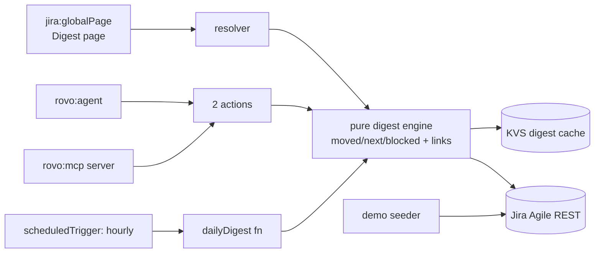

# ☀️ Standup Digest

**The 60-second standup, generated from Jira.** A Forge app for Codegeist 2026
that reads the board's activity since yesterday, groups it per person, and
turns it into a digest the whole team reads in a minute — in the UI, from a
Rovo agent, or on a schedule.

> Standup meetings die when nobody knows what moved. Standup Digest makes the
> "yesterday / today / blockers" round instant.

## Judge quick path (fresh site, 60 seconds)

> **Install → open Jira → Apps → Standup Digest → "Generate demo project" → Refresh.**
> The seeder creates the `SDD` project: 10 issues across movers, next-up,
> unassigned and a real **Blocks** link pair (issue 5 is blocked by issue 4) —
> so the digest, the blockers list and the blocked bucket all light up without
> any manual setup. It never touches existing projects.

## What it does

| Surface | Module | What the user gets |
|---|---|---|
| **Digest page** | `jira:globalPage` | Board picker + per-person digest: ✅ moved · ➡️ next · ⛔ blocked |
| **Standup Digest agent** | `rovo:agent` + 2 actions | "Give me today's standup digest" in Rovo chat — same engine |
| **MCP server** | `rovo:mcp` | Both tools exposed for your own Rovo Studio agents |
| **Hourly refresh** | `scheduledTrigger` | Caches each board's latest digest to KVS for instant loads |


## Architecture



## Quick start

```bash
npm install -g @forge/cli@latest
npm install
forge register   # put your app id in manifest.yml
forge deploy
forge install    # your site, e.g. example.atlassian.net
```

Then: Jira → Apps → **Standup Digest** → pick a board → read the digest.
For the agent: Rovo chat → browse agents → **Standup Digest**.

## Architecture

```
src/backend/digest-engine.js  pure engine: buckets + rendering (no I/O)
src/backend/jira-client.js    Jira Agile REST (board → active sprint → issues)
src/index.js                  resolver + 2 agent actions + scheduled trigger
src/frontend/index.jsx        UI Kit digest page
prompts/digest-agent-prompt.txt  agent system prompt (read-only boundaries)
tests/digest-engine.test.js   bucketing, blocking, sorting, rendering
```

**Design principles**
- *Pure core*: the digest engine is deterministic and unit-tested; I/O lives
  in the Jira client.
- *Read-only*: the app requests only `read:jira-work` + `read:jira-user` —
  nothing it does can modify your Jira.
- *Judge-installable*: `forge deploy` + install link, zero external services.

## Tests

```bash
npm test   # vitest — moved/next/blocked bucketing, unassigned handling,
           # person sorting, digest rendering, blocked flagging
```

## License

Apache-2.0 — see [LICENSE](LICENSE).
